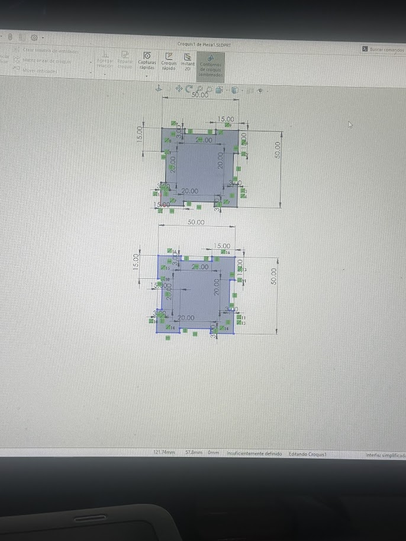
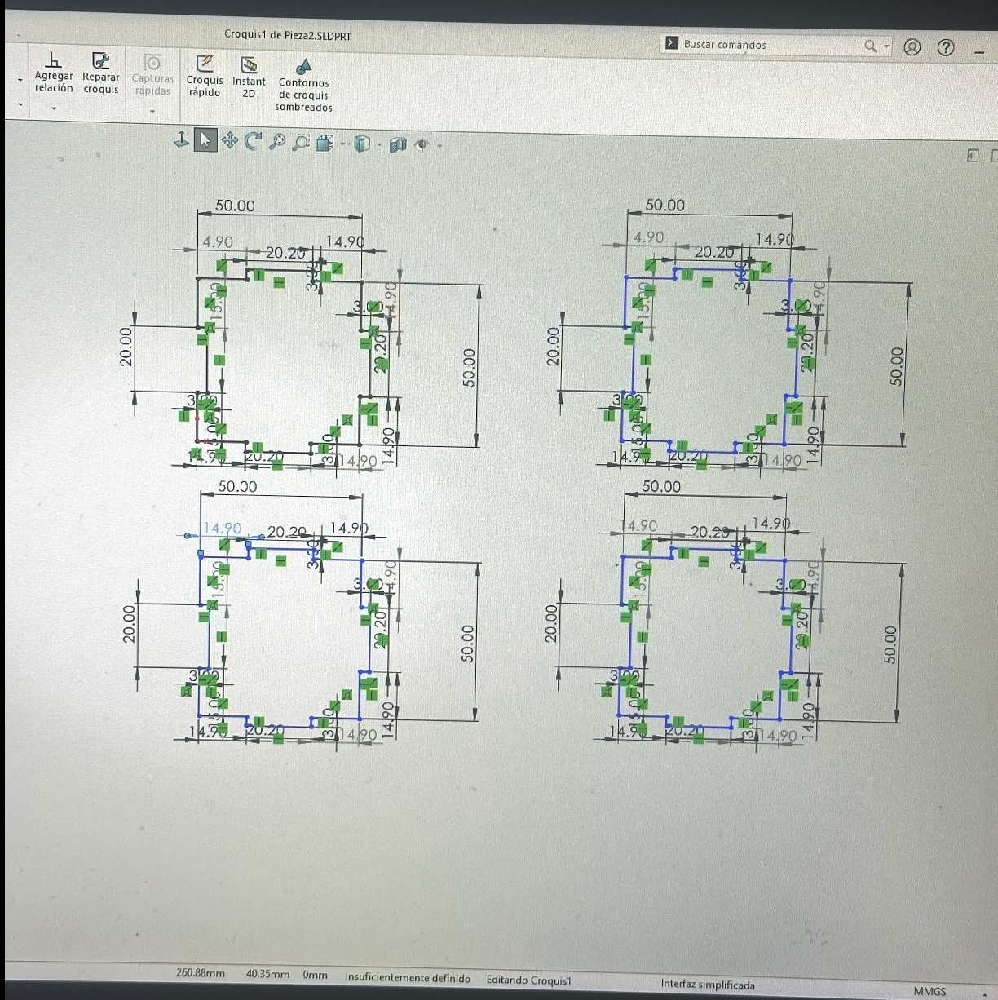
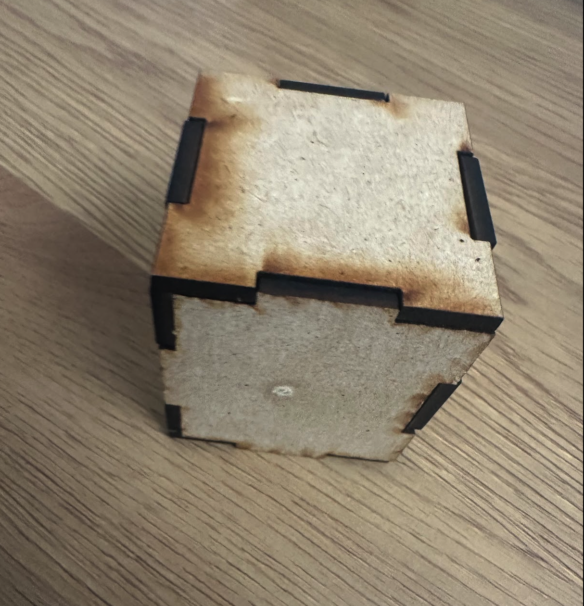

# Cortadora laser
## Introduccion  
Diseño de la tapa
El primer paso fue realizar el diseño de la tapa de la caja en SolidWorks. Para este diseño utilizamos unas medidas 
de 50 × 50, tomando en cuenta las dimensiones necesarias para que la tapa pudiera formar parte de la caja.

Diseño de las caras
Después de terminar la tapa, procedimos a diseñar las diferentes caras que formarían la caja. En esta parte    
fue necesario considerar tolerancias en las medidas, ya que las piezas debían tener el tamaño   
adecuado para poder encajar entre sí.
Las tolerancias son importantes en este tipo de fabricación, ya que si las piezas fueran exactamente del mismo tamaño. 
que las uniones, podrían no ensamblarse correctamente Por otro lado, si existiera demasiada holgura, las piezas 
podrían quedar flojas y la caja podría desarmarse.

Cortadora láser
Finalmente, utilizamos la cortadora láser para realizar los cortes de las piezas diseñadas   
Este proceso permitió llevar los diseños realizados en SolidWorks a la fabricación física de la caja
En el siguiente video se puede observar la cortadora láser en funcionamiento durante el proceso de fabricación:
[Video cortadora laser](https://youtube.com/shorts/_0JH1olHJTk?feature=share)
Después de realizar los cortes con la cortadora láser, procedimos a ensamblar todas las piezas para 
formar la caja. Gracias a las medidas y tolerancias que consideramos durante el diseño 
las diferentes partes pudieron encajar correctamente.
En la siguiente imagen se puede observar el resultado final de la caja ya armada. 
 mostrando cómo el diseño realizado en SolidWorks se convirtió en una pieza física
 