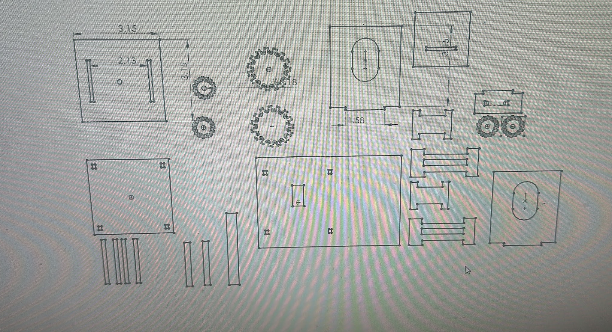
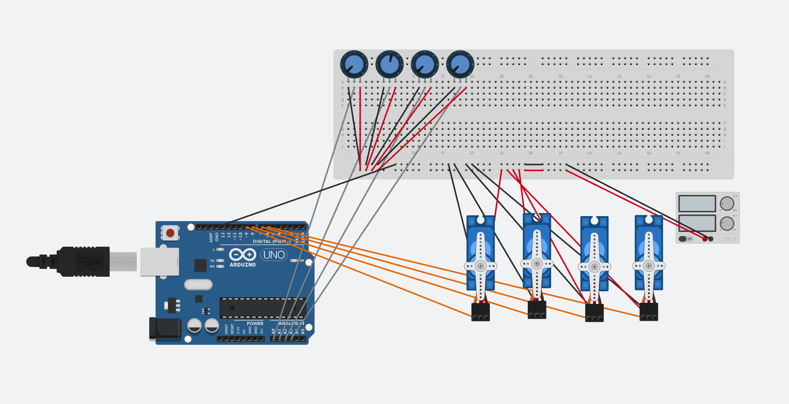
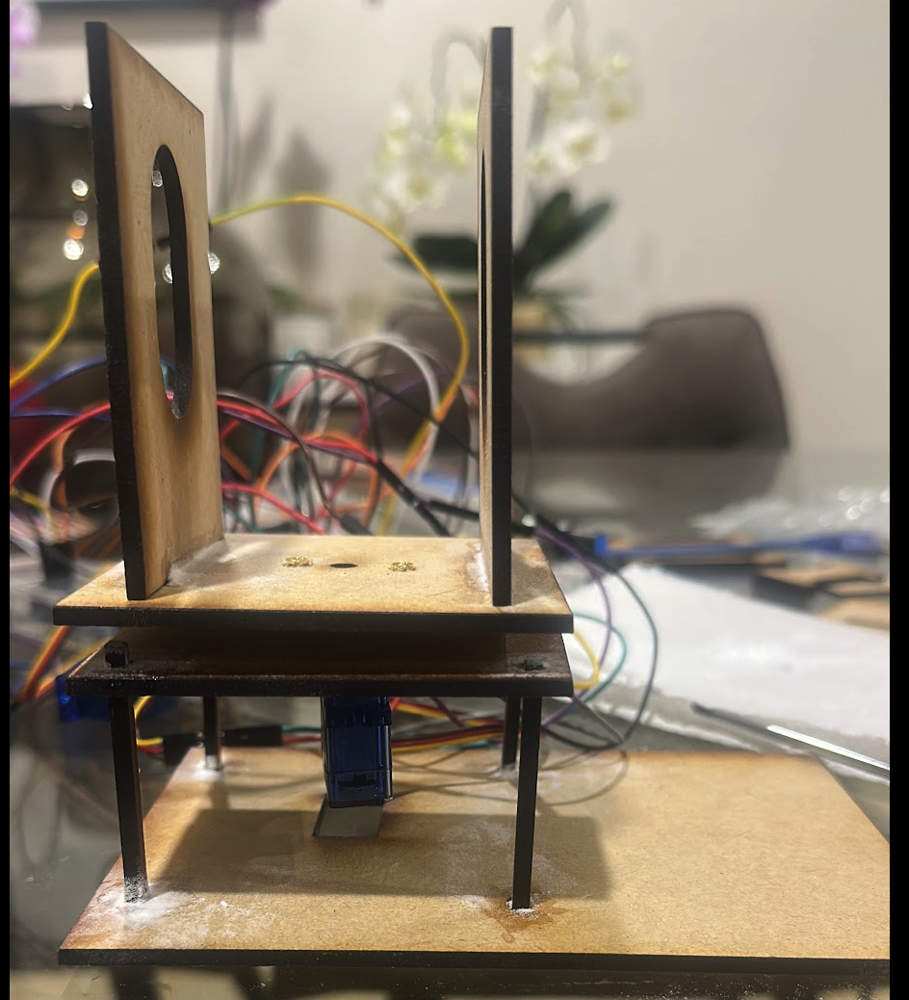
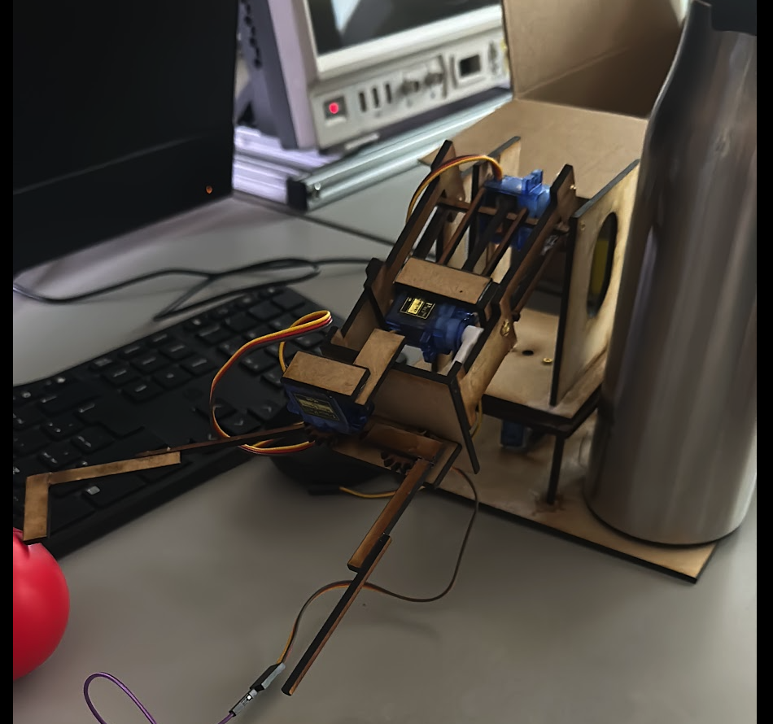
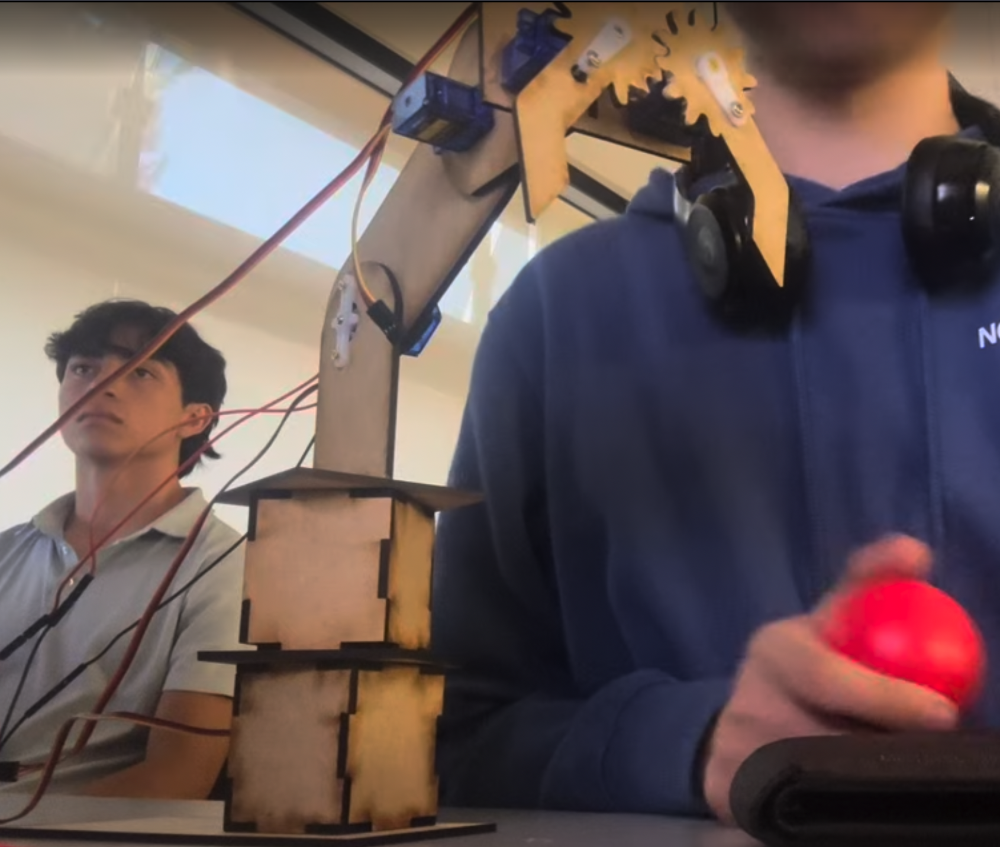
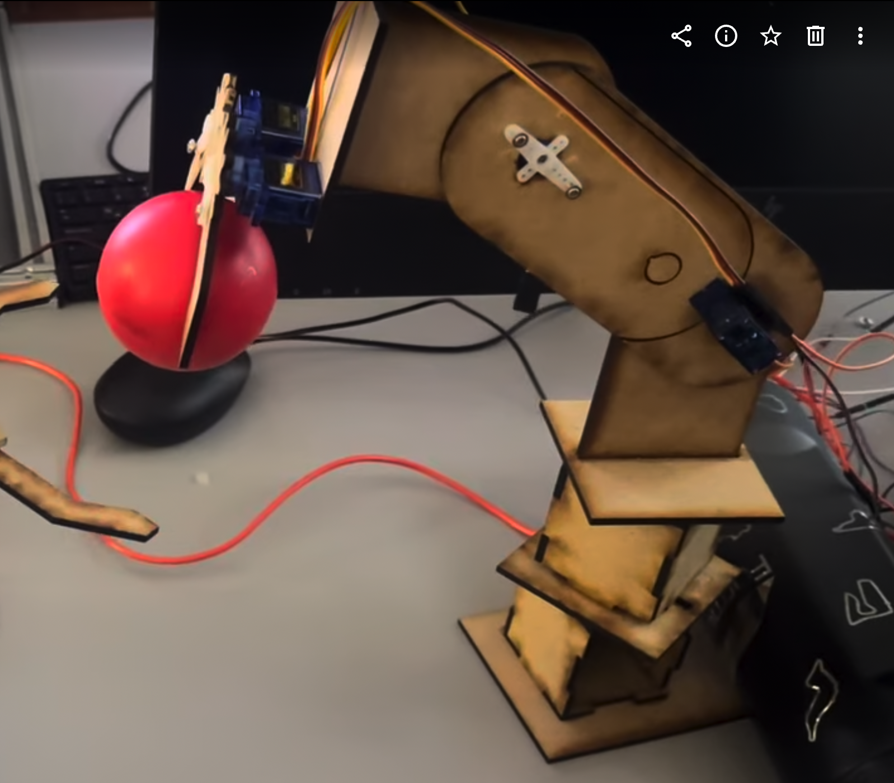

# Brazo robótico
 Durante esta actividad trabaje en equipo con emi en el diseño y construcción de un brazo robótico, utilizando Solidworks, arduino, tinkercard para simular el codigo y la cortadora laser.  

Para la estructura del brazo utilizamos MDF, mientras que para el control empleamos un Arduino Uno y varios potenciómetros. Los potenciómetros permiten modificar los valores de entrada y controlar el movimiento del brazo de acuerdo con la programación realizada.

## Material
- mdf 
- Servomotores sg90
- Arduino uno
- Protoboard
- Potenciometros
- Jumpers
- Caimanes banana
- Fuente de poder 

## planos
los planos que yo hice de la primera version que hubo un problema que era muy pesado para levantarlo. 
 

## simulacion en tinkercad
hicimos para verificar que la programacion y como ibamos a conectar el circuito funcionara
a la perfecion para que no hubiera ningun inconveniente 
 
[Simulacion tinkercad](https://www.tinkercad.com/things/giDj2CLlFwF-simulacion-de-la-programacion?sharecode=uswA-ag3knyE5HzJ8NBIPfPGHzHOrWBTtzgB9CqBByk) 

## Código

```cpp
#include <Servo.h>

Servo servo1;
Servo servo2;
Servo servo3;
Servo servo4;

int pos1 = 90;
int pos2 = 90;
int pos3 = 90;
int pos4 = 90;

void setup() {
  servo1.attach(6);
  servo2.attach(7);
  servo3.attach(8);
  servo4.attach(9);

  servo1.write(90);
  servo2.write(90);
  servo3.write(90);
  servo4.write(90);
}

void loop() {

  int lectura1 = analogRead(A0);
  int lectura2 = analogRead(A1);
  int lectura3 = analogRead(A2);
  int lectura4 = analogRead(A3);

  int nuevo1 = map(lectura1, 0, 1023, 0, 180);
  int nuevo2 = map(lectura2, 0, 1023, 0, 180);
  int nuevo3 = map(lectura3, 0, 1023, 0, 180);
  int nuevo4 = map(lectura4, 0, 1023, 0, 180);

  if (abs(nuevo1 - pos1) >= 2) {
    pos1 = nuevo1;
    servo1.write(pos1);
  }

  if (abs(nuevo2 - pos2) >= 2) {
    pos2 = nuevo2;
    servo2.write(pos2);
  }

  if (abs(nuevo3 - pos3) >= 2) {
    pos3 = nuevo3;
    servo3.write(pos3);
  }

  if (abs(nuevo4 - pos4) >= 2) {
    pos4 = nuevo4;
    servo4.write(pos4);
  }

  delay(20);
}
```
## Primera version del brazo 
En esta primera version tuvimos el problema que era demasiado pesado el brazo 
entonces el brazo no funcionaba bien y ademas le pasamos demasiado amperaje a los servos que tenian tics. 
 
  
[video brazo version 1](https://youtube.com/shorts/OLW3_Hx73OY?feature=share) 

## Segunda version del brazo 
En esta version hicimos mas ligero el brazo ahora ya no teniamos problema de que era muy pesado para los 
servos sg90 y pudimos pasar la pelota con otro robot. 
 
  
[video brazo version 2](https://www.youtube.com/shorts/CPqJnBwnIzU) 